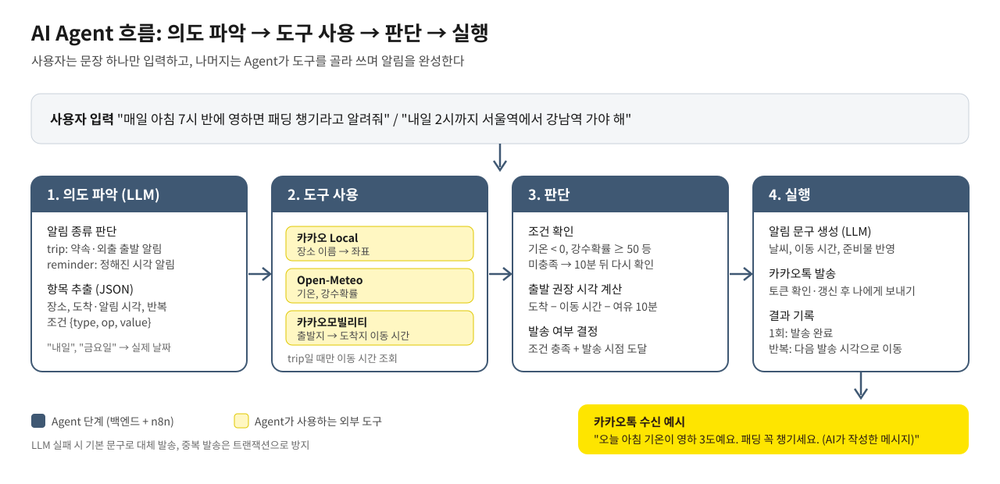
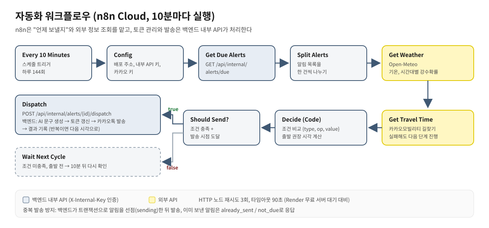
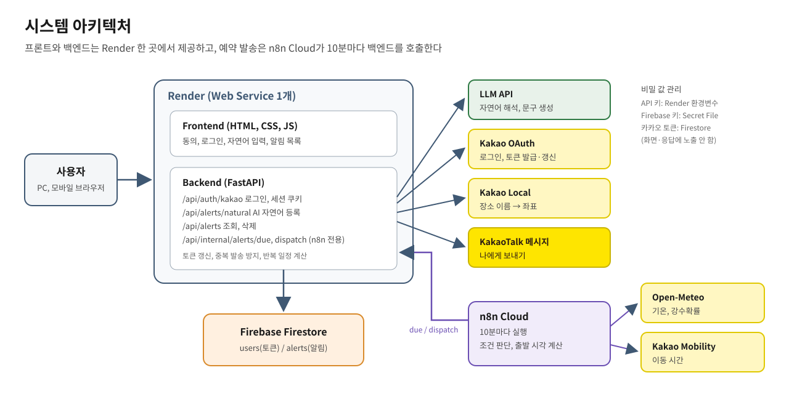

# AI 기반 외출 알림 서비스 (AI 외출톡)

> 외출 계획이나 받고 싶은 알림을 평소 말하듯 한 문장으로 입력하면, AI가 내용을 해석하고 날씨와 이동 시간을 확인해 알맞은 시각에 카카오톡으로 알려주는 서비스

- 배포 URL: https://ai-outing-talk.onrender.com
- 과제 요구사항 충족 현황: [11장](#11-과제-요구사항-충족-현황)

<br>

## 1. 프로젝트 소개

### 문제 정의
- 약속 시간에 맞춰 나가려면 날씨, 이동 시간, 준비물을 각각 다른 앱에서 확인해야 한다.
- 확인했더라도 출발 시각을 놓치거나 우산, 겉옷을 챙기는 것을 잊기 쉽다.
- 날씨 앱과 지도 앱은 정보를 보여줄 뿐, 사용자의 일정에 맞춰 먼저 알려주지 않는다.

### 해결 방향
- 입력은 **자연어 한 문장**으로 끝낸다.
- 흩어진 정보(날씨, 이동 시간)를 **AI가 모아 하나의 안내**(출발 시각, 챙길 것)로 만든다.
- 사용자가 앱을 다시 열지 않아도 **정해진 시각에 카카오톡으로 먼저** 알린다.

### 주요 기능

| 기능 | 설명 |
|---|---|
| 카카오 로그인 | 개인정보 수집 동의 후 카카오 계정으로 로그인 |
| 자연어 알림 등록 | 문장 하나를 AI가 해석해 알림 종류, 시각, 장소, 조건을 자동으로 정리 |
| 약속·외출 알림 (trip) | 출발지에서 도착지까지 이동 시간을 계산해 출발 권장 시각에 알림 |
| 정해진 시각 알림 (reminder) | 지정한 시각에 알림, **매일·평일 반복** 지원 |
| 날씨 조건 | "영하면", "비 오면"처럼 조건이 맞을 때만 발송 |
| AI 알림 문구 | 발송 시점의 날씨, 이동 시간, 준비물을 반영해 AI가 메시지 작성 |
| 카카오톡 자동 발송 | n8n이 10분마다 확인해 카카오톡 "나에게 보내기"로 발송 |
| 알림 관리 | 알림 목록, 상태(대기·반복 중·발송 완료·만료) 확인, 삭제 |

### 입력 예시

| 입력 문장 | 해석 결과 |
|---|---|
| 내일 오후 2시까지 서울역에서 강남역 가야 해 | trip: 도착 14:00, 이동 시간에 맞춰 출발 알림 |
| 금요일 7시 홍대 약속, 비 오면 알려줘 | trip: 강수확률 50% 이상일 때만 출발 알림 |
| 매일 아침 7시에 강수확률이 40% 이상이면 우산 챙기라고 알려줘 | reminder: 매일 07:00, 강수확률 40% 이상일 때 |
| 평일마다 8시에 회사 날씨 알려줘 | reminder: 평일 08:00, 회사 위치 날씨 |

### 입력 시 유의사항

사용자 테스트에서 나온 혼동을 줄이기 위해 아래 규칙을 화면에 안내하고 있습니다.

- 약속 알림과 반복 알림은 한 문장에 같이 적지 않고 **하나씩 나눠서** 등록합니다.
- 알림을 받을 **시각은 반드시 입력**해야 합니다. "7시부터 20시까지"처럼 날씨를 확인할 시간 범위를 지정하는 기능은 현재 지원하지 않습니다.
- 날씨 조건은 알림 시각부터 **12시간 동안의 예보**로 확인합니다.
- 등록된 알림은 카카오톡 **'나와의 채팅'** 으로 전달되며, 알림음이나 푸시는 발생하지 않습니다.
- 날씨 조건이 있는 알림은 **조건을 충족할 때만** 발송됩니다.

<br>

## 2. 팀원 역할

| 이름 | 역할 | 담당 업무 |
|---|---|---|
| 박유안 | 팀장 · Backend | 저장소·프로젝트 구조 구성, FastAPI 서버 구현, Firebase Firestore 연동, 카카오 로그인 및 메시지 발송 연동, 알림 등록·조회·삭제 API, n8n 연동용 내부 API, 카카오 Developers 운영 환경 설정(Redirect URI·도메인·앱 멤버), 팀 작업 순서 조율 |
| 조근화 | Frontend · 문서 · 사용자 테스트 | 동의·로그인·알림 등록·알림 목록 화면 구현, 기획서·기능 요구 명세서·피드백 기록 작성, 사용자 테스트 설계와 참여자 모집·진행·응답 취합, 피드백 분석 및 팀 공유, 발표 자료 제작 |
| 박상훈 | Automation · Infra | n8n 운영 환경 구성 및 10분 주기 예약 발송 워크플로우 구현, 날씨·이동 시간 조회 연동, Render 배포 및 운영, 프론트엔드 API 연동, 피드백 반영 화면 개선, 아키텍처·Agent·워크플로우 다이어그램 작성 |
| 김종훈 | AI | 자연어 해석 프롬프트 설계 및 개선, 알림 문구 생성 프롬프트 작성, LLM 응답 검증과 예외 처리, 기술 요소 명세 및 AI 활용 명세 작성 |

### 협업 방식
- **브랜치 전략**: `main`(제출용) ← `develop`(통합) ← `feature/*`(기능별). 모든 변경은 PR로 develop에 머지
- **코드 리뷰**: PR 단위로 변경 내용과 테스트 방법을 기록하고 리뷰 후 머지
- **진행 공유**: 디스코드 포럼에 날짜별 완료·예정 작업을 기록하고, 담당이 비는 작업은 재배정
- **인터페이스 합의**: 백엔드와 n8n 사이 API 경로, 데이터 형식, 예외 처리 규칙을 먼저 합의한 뒤 각자 구현
- **피드백 반영 절차**: 사용자 테스트 응답을 취합·분석해 개선 방향을 제안하고, 팀 합의 후 담당자가 반영하고 재배포
- 날짜별 진행 기록과 의사결정은 [docs/progress_log.md](docs/progress_log.md)에 정리했습니다.

<br>

## 3. 기술 스택

| 구분 | 기술 | 선정 이유 |
|---|---|---|
| Backend | FastAPI (Python) | 팀이 학습한 언어이며, API 문서(`/docs`)가 자동 생성되어 연동 확인이 빠름 |
| Frontend | HTML, CSS, JavaScript | 빌드 과정 없이 백엔드가 그대로 제공할 수 있어 짧은 일정에 적합 |
| Database | Firebase Firestore | 서버 구축 없이 사용할 수 있고 무료 범위에서 운영 가능 |
| AI | LLM API (OpenAI 호환 Chat Completions) | 자연어 해석, 알림 문구 생성 |
| 지도·이동 | 카카오 Local, 카카오모빌리티 길찾기 | 장소 이름 → 좌표 변환, 자동차 이동 시간 계산 |
| 날씨 | Open-Meteo | API 키 없이 위경도로 기온·강수확률 조회 |
| 메시지 | 카카오톡 메시지 API (나에게 보내기) | 사용자가 이미 쓰는 메신저로 알림 전달, 별도 심사 없이 사용 가능 |
| 자동화 | n8n Cloud | 예약 발송을 워크플로우로 구성, 컴퓨터가 꺼져도 24시간 실행 |
| 배포 | Render | 백엔드와 프론트를 한 서비스로 무료 배포 |
| 협업 | Git, GitHub | 기능 브랜치와 PR 기반으로 변경 이력 관리 |

### 기술적 의사결정
- **프론트를 백엔드와 같은 주소에서 제공**: 처음에는 프론트(Vercel)와 백엔드(Render)를 나눠 배포할 계획이었다. 그런데 로그인 상태를 쿠키로 유지하는 구조라 도메인이 다르면 아이폰 사파리 등에서 쿠키가 차단될 수 있었다. 그래서 FastAPI가 `frontend/`를 함께 제공하도록 바꿨고, 쿠키·CORS·리다이렉트 설정이 단순해졌다.
- **날씨 API**: 기상청 단기예보는 격자 좌표 변환과 키 승인 시간이 필요했다. 일정상 키 없이 위경도로 바로 조회할 수 있는 Open-Meteo를 선택했다.
- **n8n Cloud, 10분 간격**: 로컬 n8n은 컴퓨터가 꺼지면 멈춘다. Cloud 체험판의 실행 횟수 제한(1,000회) 안에서 운영하기 위해 실행 간격을 10분으로 정했다.
- **토큰과 발송은 백엔드에서 관리**: n8n은 백엔드 내부 API만 호출한다. 카카오 토큰 저장·갱신과 발송은 백엔드 한 곳에서 처리해 보안과 중복 발송 방지를 단순하게 유지했다.
- **카카오 앱 분리 운영**: 카카오맵 API 무료 쿼터가 개발자 계정당 앱 1개로 제한되어, 로그인·메시지 발송용 앱과 카카오맵용 앱을 나눠 사용했다.

<br>

## 4. 핵심 AI 활용

과제 필수 기술 요소 중 **AI Agent**와 **자동화 워크플로우**를 사용합니다.
기술 요소별 상세 근거, 프롬프트 설계, 적용하지 않은 기술과 이유는 [docs/tech_elements.md](docs/tech_elements.md)에 정리했습니다.



| 기술 요소 | 적용 위치 | 설명 |
|---|---|---|
| AI Agent | 알림 등록, 발송 | 사용자 의도(약속인지, 반복 알림인지)를 파악하고 장소 검색·날씨·이동 시간 도구의 결과를 바탕으로 출발 시각과 준비물을 판단해 안내 |
| 자동화 워크플로우 | n8n | 10분마다 발송 대상 조회 → 날씨·이동 시간 조회 → 조건 판단 → 발송 요청 |

### AI 처리 흐름
1. 사용자가 문장 하나를 입력한다.
2. LLM이 문장을 해석해 알림 종류(trip/reminder), 장소, 시각, 반복, 날씨 조건을 JSON으로 정리한다.
3. 카카오 Local로 장소 좌표를 찾아 Firestore에 저장한다.
4. n8n이 발송 시점이 된 알림의 날씨와 이동 시간을 조회하고 조건을 판단한다.
5. 백엔드가 LLM으로 상황에 맞는 문구를 생성해 카카오톡으로 보낸다.
6. 반복 알림은 다음 발송 시각으로 옮긴다.

### 자동화 워크플로우 (n8n)



### 프롬프트 설계
- **해석 프롬프트**: 현재 시각과 요일을 함께 넘겨 "내일", "금요일" 같은 표현을 실제 날짜로 바꾼다. 도착 시각과 알림 시각, 준비물과 날씨 조건을 각각 구분해 추출한다. 출력은 정해진 JSON 형식만 허용하고, 알 수 없는 값은 지어내지 않고 `null`로 두게 한다.
- **입력 제약 처리**: 날씨를 확인할 시간 범위를 지정하는 입력은 지원 범위를 벗어나므로 거절하고, 알림을 받을 시각을 한 시점으로 입력하도록 안내한다. 독립적인 알림이 여러 건으로 분류되면 하나씩 등록하도록 안내한다. 한 약속에 도착 시각과 별도 알림 시각이 함께 있는 경우는 한 건으로 처리한다.
- **문구 프롬프트**: 주어진 날씨·이동 시간만 사용하고 2~3문장, 120자 이내로 쓰게 한다. 강수확률 50% 이상이면 우산, 5도 이하면 따뜻한 옷을 권하도록 규칙을 정했다.
- **실패 대비**: LLM 응답이 실패하면 정해진 형식의 기본 문구로 발송하고 목록에 '기본 알림'으로 표시해, 알림 자체가 빠지지 않게 했다.

### 적용하지 않은 기술과 이유
| 기술 | 이유 |
|---|---|
| RAG | 필요한 정보(날씨, 이동 시간, 장소)가 문서 지식이 아니라 실시간 데이터라, 문서 검색 대신 실시간 API를 Agent의 도구로 사용 |
| 멀티모달 AI | 입력은 문장, 출력은 카카오톡 텍스트라 이미지·음성 처리가 필요 없음 |
| Long-term Memory | 대화형 서비스가 아니라 이전 대화 맥락이 필요 없음. 알림 설정과 발송 이력은 Firestore에 저장 |

<br>

## 5. 시스템 아키텍처



- 프론트와 백엔드는 Render 한 서비스에서 제공합니다.
- n8n Cloud가 10분마다 백엔드 내부 API를 호출해 발송 대상을 확인합니다.
- 카카오 토큰은 Firestore, API 키는 Render 환경변수, Firebase 키는 Secret File로 관리합니다.

<br>

## 6. 프로젝트 구조

```text
ai-outing-talk/
├── automation/
│   ├── outing_alert_workflow.json   # n8n 예약 알림 워크플로우
│   └── README.md                    # 워크플로우 설명, 설정, 테스트 시나리오
├── backend/
│   ├── app/
│   │   ├── config.py                # 환경변수 및 설정
│   │   ├── firebase.py              # Firestore 연결
│   │   ├── main.py                  # 서버 시작점, 라우터·프론트 서빙
│   │   ├── routers/
│   │   │   ├── auth.py              # 카카오 로그인, 세션 확인
│   │   │   ├── alerts.py            # 알림 등록(자연어 포함)·조회·삭제
│   │   │   └── internal.py          # n8n 전용 API (due, dispatch)
│   │   ├── schemas/
│   │   │   └── alert.py             # 요청 데이터 형식
│   │   └── services/
│   │       ├── alert.py             # 알림 저장·조회
│   │       ├── dispatch.py          # 발송 대상 조회, 발송, 반복 처리
│   │       ├── kakao.py             # 카카오 토큰·메시지 API
│   │       ├── llm.py               # 자연어 해석, 알림 문구 생성
│   │       ├── location.py          # 장소 이름 → 좌표
│   │       ├── session.py           # 로그인 세션 쿠키
│   │       ├── timeutil.py          # 한국 시각, 반복 일정 계산
│   │       └── user.py              # 사용자·토큰 저장, 토큰 갱신
│   ├── tests/                       # Firestore 읽기·쓰기, LLM 해석 테스트
│   ├── .env.example                 # 환경변수 예시 (.env는 커밋하지 않음)
│   └── requirements.txt
├── docs/
│   ├── project_proposal.md          # 기획서
│   ├── functional_requirements.md   # 기능 요구 명세서
│   ├── feedback_log.md              # 사용자 피드백 기록
│   ├── deployment_guide.md          # 배포 및 연동 가이드, 데이터 형식
│   ├── tech_elements.md             # 기술 요소 및 AI 활용 명세
│   ├── progress_log.md              # 날짜별 진행 기록, 의사결정
│   └── images/                      # 아키텍처, Agent, 워크플로우 다이어그램
├── frontend/
│   ├── css/style.css
│   ├── js/main.js
│   └── index.html
├── .gitignore
└── README.md
```

<br>

## 7. 설치 및 실행 방법

### 요구사항
- Python 3.10 이상
- Firebase 서비스 계정 키(JSON)
- 카카오 디벨로퍼스 앱 (REST API 키, Client Secret, Redirect URI, 카카오맵 API 활성화)
- LLM API 키 (OpenAI 호환 형식)

### 로컬 실행
```bash
git clone https://github.com/U-an74/ai-outing-talk.git
cd ai-outing-talk/backend

python -m venv venv
source venv/bin/activate        # Windows: venv\Scripts\activate
pip install -r requirements.txt

cp .env.example .env            # 값 입력
uvicorn app.main:app --reload --port 8000
```

- 서비스 화면: `http://localhost:8000` (백엔드가 프론트를 함께 제공하므로 Live Server 불필요)
- API 문서: `http://localhost:8000/docs`
- 상태 확인: `http://localhost:8000/health`, `http://localhost:8000/health/firebase`

### 환경변수

| 변수 | 설명 |
|---|---|
| `FIREBASE_PROJECT_ID`, `FIREBASE_CREDENTIALS_PATH` | Firebase 프로젝트와 서비스 계정 키 경로 |
| `KAKAO_REST_API_KEY`, `KAKAO_CLIENT_SECRET`, `KAKAO_REDIRECT_URI` | 카카오 로그인·메시지·지도 API |
| `APP_SESSION_SECRET` | 로그인 쿠키 서명용 임의 문자열 |
| `COOKIE_SECURE` | 로컬 `false`, 배포(HTTPS) `true` |
| `FRONTEND_URL` | 로그인 후 이동할 주소 (기본 `/`) |
| `INTERNAL_API_KEY` | n8n 내부 API 인증 키 |
| `LLM_BASE_URL`, `LLM_API_KEY`, `LLM_MODEL` | LLM API 설정 |

### 배포
Render 설정, Firebase 키 업로드, 카카오 콘솔 설정, n8n 연결은 [docs/deployment_guide.md](docs/deployment_guide.md)와 [automation/README.md](automation/README.md)에 정리했습니다.

### 주요 API

| 메서드 | 경로 | 설명 |
|---|---|---|
| GET | `/api/auth/kakao/login` | 카카오 로그인 |
| GET | `/api/auth/kakao/me` | 로그인 확인 |
| POST | `/api/alerts/natural` | 자연어 한 문장으로 알림 등록 |
| GET | `/api/alerts` | 내 알림 목록 |
| DELETE | `/api/alerts/{id}` | 알림 삭제 |
| GET | `/api/internal/alerts/due` | 발송 대상 조회 (n8n, `X-Internal-Key`) |
| POST | `/api/internal/alerts/{id}/dispatch` | AI 문구 생성 후 카카오톡 발송 (n8n, `X-Internal-Key`) |

<br>

## 8. 사용자 테스트 결과

- 테스터: 6명
- 기간: 2026년 11월 23일 ~ 11월 24일
- 방식: 배포된 서비스를 직접 사용한 뒤 6개 문항에 응답
- 상세 기록: [docs/feedback_log.md](docs/feedback_log.md)

테스트 중간인 11월 23일 밤에 1차 개선을 배포했고, 이후 참여자는 개선된 화면으로 테스트했습니다.

| 피드백 | 반영 내용 |
|---|---|
| 약속과 반복 알림을 한 문장에 함께 입력하면 하나만 등록되고 누락 안내가 없음 | 알림 유형을 두 가지로 구분해 안내하고, 한 번에 하나씩 등록하도록 문구 추가 |
| "7시~20시 강수확률 40% 이상"처럼 시간 범위를 입력하면 알림 발송 시각으로 잘못 해석됨 | 알림 받을 시각을 필수로 입력하도록 안내하고 시간 범위 미지원을 명시. 해석 프롬프트에서 도착 시각·알림 시각·준비물·날씨 조건을 구분하도록 개선 |
| 카카오톡이 오지 않아 서비스가 고장난 것으로 오인 | 알림 목록 화면에 수신 위치('나와의 채팅'), 알림음 미발생, 유형별 발송 조건 안내 문구 추가 |

재사용 의향은 평균 2.7점이었습니다. 가장 많이 나온 요청은 알림 수정 기능(3명)이었고, 도착지 주소 함께 제공과 출발 권장 시각 화면 표시가 뒤를 이었습니다. 낮은 점수를 준 참여자는 "검색하는 것과 알림을 설정하는 것이 비슷한 일이라 이중으로 일하는 느낌", "현재 쓰는 캘린더와 차별점이 부족하다"는 이유를 들었습니다. 이 지적은 기능 결함이 아니라 서비스의 차별점에 관한 것으로, 미반영 항목과 함께 [docs/feedback_log.md](docs/feedback_log.md)에 향후 과제로 정리했습니다.

<br>

## 9. AI 윤리 및 개인정보

- AI가 작성한 카카오톡 메시지에는 끝에 **"(AI가 작성한 메시지)"**를 표시하고, 화면에도 AI 작성 여부를 표시합니다.
- 개인정보(카카오 회원번호, 알림에 입력한 장소·시각)는 **동의 화면을 거친 뒤** 수집하며, 알림 생성과 발송 목적으로만 사용합니다.
- 카카오 토큰은 서버(Firestore)에만 저장하고 화면이나 응답에 노출하지 않습니다.
- 사용자 테스트 기록에는 참여자 실명 대신 식별 기호를 사용하며, 연락처와 카카오 계정 정보는 수집하지 않았습니다.

<br>

## 10. 링크
- 배포 URL: https://ai-outing-talk.onrender.com
- 문서: [기획서](docs/project_proposal.md) · [기능 요구 명세서](docs/functional_requirements.md) · [기술 요소 명세](docs/tech_elements.md) · [진행 기록](docs/progress_log.md) · [배포 가이드](docs/deployment_guide.md) · [피드백 기록](docs/feedback_log.md)

<br>

## 11. 과제 요구사항 충족 현황

| 과제 요구사항 | 충족 내용 | 위치 |
|---|---|---|
| 생성형 AI 또는 AI Agent가 핵심 기능 | 자연어 해석과 알림 문구 생성이 없으면 서비스가 동작하지 않음 | [4장](#4-핵심-ai-활용), `backend/app/services/llm.py` |
| 필수 기술 요소 2개 이상 | AI Agent, 자동화 워크플로우 | [tech_elements.md](docs/tech_elements.md) |
| 프롬프트·RAG·메모리 적용 근거 | 프롬프트 설계 이유, RAG·메모리 미적용 이유 | [4장](#4-핵심-ai-활용), [tech_elements.md](docs/tech_elements.md) |
| 노코드 자동화 + Python | n8n Cloud + FastAPI | `automation/`, `backend/` |
| 문제 정의 | 1장 문제 정의, 기획서 | [1장](#1-프로젝트-소개), [기획서](docs/project_proposal.md) |
| 기능·비기능 요구사항 | 기능 요구 명세서 | [functional_requirements.md](docs/functional_requirements.md) |
| 서비스 아키텍처 설계·문서화 | 아키텍처 다이어그램, API 목록, 데이터 형식 | [5장](#5-시스템-아키텍처), [배포 가이드](docs/deployment_guide.md) |
| 기술 스택 선정 이유 | 3장 표와 기술적 의사결정 | [3장](#3-기술-스택) |
| 외부 접근 가능한 배포 | Render 배포 | https://ai-outing-talk.onrender.com |
| 실사용자 5명 이상 피드백·반영 | 6명 테스트 기록, 지적 3건 반영 후 재배포 | [8장](#8-사용자-테스트-결과), [feedback_log.md](docs/feedback_log.md) |
| 팀원 역할 분담과 협업 과정 | 2장 역할, 협업 방식, 진행 기록 | [2장](#2-팀원-역할), [progress_log.md](docs/progress_log.md) |
| 진행 과정 문서화 | 날짜별 완료 작업, 의사결정, 문제 해결 | [progress_log.md](docs/progress_log.md) |
| Git 버전 관리 | 기능 브랜치와 PR 기반 머지 기록 | GitHub Pull requests |
| AI 생성 콘텐츠 명시 | 메시지 끝 "(AI가 작성한 메시지)", 화면 표시 | [9장](#9-ai-윤리-및-개인정보) |
| 개인정보 동의·안전 관리 | 동의 화면, 토큰 비노출, 비밀 값 분리 보관 | [9장](#9-ai-윤리-및-개인정보) |
