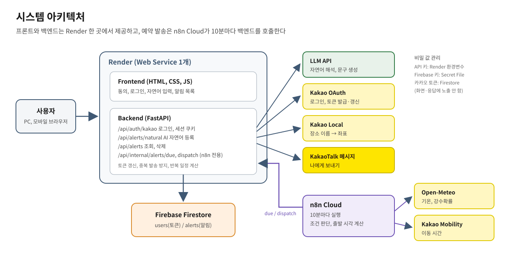
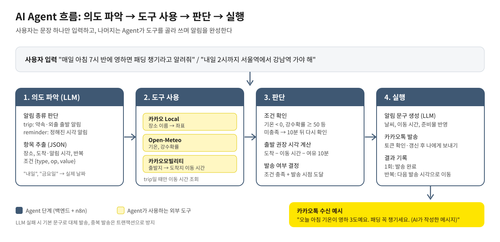
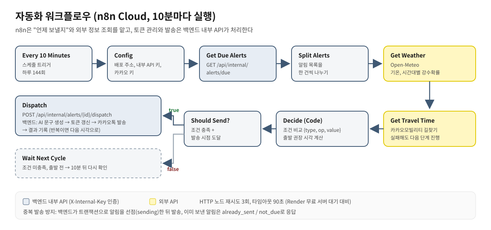

# 기술 요소 및 AI 활용 명세

과제 필수 기술 요소 5가지(AI Agent, RAG, 멀티모달 AI, 자동화 워크플로우, Long-term Memory) 중 **AI Agent**와 **자동화 워크플로우** 2가지를 서비스의 핵심으로 사용합니다.

| 기술 요소 | 적용 | 핵심 근거 | 관련 코드 |
|---|---|---|---|
| AI Agent | 적용 | LLM이 의도를 해석하고 문구를 생성하며, 백엔드와 n8n이 장소·날씨·이동 시간 조회와 발송 판단을 수행 | `backend/app/services/llm.py`, `routers/alerts.py`, `services/dispatch.py` |
| 자동화 워크플로우 | 적용 | n8n이 10분마다 발송 대상 조회 → 외부 정보 조회 → 조건 판단 → 발송 요청을 자동 실행 | `automation/outing_alert_workflow.json` |
| RAG | 미적용 | 아래 "적용하지 않은 기술과 이유" 참고 | - |
| 멀티모달 AI | 미적용 | 입력과 출력이 모두 텍스트(문장, 카카오톡 메시지) | - |
| Long-term Memory | 미적용 | 대화형 서비스가 아니라 이전 대화 맥락이 필요 없음. 알림 설정·발송 이력만 Firestore에 저장 | - |

<br>

## 1. 시스템 아키텍처



<br>

## 2. AI Agent



과제 정의: *사용자 의도를 파악하고 도구를 활용하여 목표를 달성하는 Agent*

이 서비스의 목표는 "사용자가 문장 하나만 입력하면, 알맞은 때에 필요한 내용을 카카오톡으로 받게 하는 것"입니다. Agent는 이 목표를 위해 네 단계를 거칩니다.

### 2-1. 의도 파악 (LLM)

사용자가 입력한 문장을 LLM이 해석해 알림 종류와 필요한 항목을 정리합니다.

| 알림 종류 | 의미 | 예시 |
|---|---|---|
| `trip` | 약속·외출. 도착지와 도착 시각 기준 출발 알림 | "내일 2시까지 서울역에서 강남역 가야 해" |
| `reminder` | 정해진 시각 알림. 매일·평일 반복, 날씨 조건 지원 | "매일 아침 7시 반에 영하면 패딩 챙기라고 알려줘" |

한국 표준시 2026년 11월 23일 밤에 “매일 아침 7시 반에 회사 기온이 영하면 패딩 챙기라고 알려줘”를 입력했을 때의 모델 응답 예시입니다.

```json
{
  "input_issue": null,
  "kind": "reminder",
  "departure": null,
  "destination": null,
  "arrival_at": null,
  "send_at": "2026-11-24T07:30:00+09:00",
  "repeat": "daily",
  "location": "회사",
  "condition": { "type": "temperature", "op": "<", "value": 0 },
  "items_hint": "패딩",
  "message": "회사 기온이 영하이면 패딩을 챙기세요."
}
```

### 2-2. 도구 사용

| 도구 | 사용 시점 | 역할 |
|---|---|---|
| 카카오 Local | 알림 등록 시 | 장소 이름(예: "강남역")을 좌표로 변환 |
| Open-Meteo | 발송 시점 (n8n) | 현재 기온, 앞으로의 시간대별 강수확률 |
| 카카오모빌리티 길찾기 | 발송 시점, trip만 (n8n) | 출발지 → 도착지 자동차 이동 시간 |
| 카카오톡 메시지 | 발송 | 사용자 본인에게 메시지 전송 |

### 2-3. 판단

| 판단 | 규칙 |
|---|---|
| 조건 확인 | `{type, op, value}` 형식. 기온은 현재 기온, 강수는 앞으로의 강수확률 최댓값과 비교 |
| 출발 권장 시각 | 도착 시각 − 이동 시간 − 여유 10분 |
| 발송 시점 | 출발 기준 알림은 권장 시각 10분 전부터 확인한다. 이동 시간이 없으면 도착 60분 전부터 확인한다. 별도 알림 시각을 지정한 약속과 시각 알림은 설정 시각 이후의 실행 주기부터 확인한다. |
| 조건 미충족 | 다음 10분 주기에 다시 확인한다. 시각 알림은 설정 시각부터 1시간이 지나면 반복 알림은 다음 일정으로 이동하고 1회 알림은 만료한다. |

### 2-4. 실행

1. LLM이 날씨, 이동 시간, 출발 권장 시각, 준비물을 반영해 2~3문장 문구 생성
2. 카카오 토큰이 만료 5분 전이면 갱신 후 Firestore에 반영
3. 카카오톡 API로 발송하고 사용자는 ‘나와의 채팅’에서 수신. 모델이 생성한 본문에는 “(AI가 작성한 메시지)” 표시
4. 결과 기록: 1회 알림은 발송 완료, 반복 알림은 다음 발송 시각으로 이동

### 2-5. 단순 API 호출과 다른 점

- **입력 형식이 정해져 있지 않음**: 같은 서비스에서 약속 알림과 반복 알림을 문장만 보고 구분합니다.
- **필요한 도구를 상황에 따라 다르게 사용**: trip이면 이동 시간까지 조회하고, reminder면 날씨만 확인합니다.
- **결과에 따라 행동이 달라짐**: 조건이 맞지 않으면 보내지 않고 다시 확인하며, 반복 알림은 다음 일정을 스스로 잡습니다.

<br>

## 3. 자동화 워크플로우



과제 정의: *여러 서비스를 연동한 자동화 파이프라인*

| 노드 | 역할 |
|---|---|
| Every 10 Minutes | 10분마다 실행 (하루 144회) |
| Config | 배포 주소, 내부 API 키, 카카오 키 |
| Get Due Alerts | 백엔드에서 지금 확인할 알림 목록 조회 |
| Split Alerts | 알림을 한 건씩 나누기 |
| Get Weather | Open-Meteo 날씨 조회 |
| Get Travel Time | 카카오모빌리티 이동 시간 조회 (실패해도 다음 단계 진행) |
| Decide | 조건 비교, 출발 권장 시각 계산, 발송 여부 결정 |
| Should Send? | true → Dispatch, false → Wait Next Cycle |
| Dispatch | 백엔드에 발송 요청 (AI 문구 생성, 토큰 갱신, 발송, 기록) |
| Wait Next Cycle | 다음 주기에 다시 확인 |

### 설계 결정

- **n8n Cloud 사용**: 로컬 n8n은 컴퓨터가 꺼지면 멈춥니다. 예약 발송은 24시간 동작해야 해서 Cloud를 선택했습니다.
- **10분 간격**: 체험판 실행 한도(1,000회)를 고려해 발송 대상과 조건을 확인하는 주기를 10분으로 정했습니다.
- **역할 분리**: n8n은 "언제 보낼지"와 외부 정보 조회만 맡습니다. 카카오 토큰 같은 비밀 정보와 발송은 백엔드 한 곳에서 처리해 보안과 중복 발송 방지를 단순하게 유지했습니다.
- **장애 대비**: HTTP 노드는 재시도 3회, 타임아웃 90초로 Render 무료 서버가 잠들었다 깨어나는 시간을 견딥니다. 백엔드는 트랜잭션으로 알림을 선점해 같은 알림이 두 번 발송되지 않게 합니다.

<br>

## 4. 프롬프트 설계

### 4-1. 자연어 해석 프롬프트

| 설계 | 이유 |
|---|---|
| 한국 표준시·요일을 함께 전달 | 날짜 표현과 상대 시각을 변환하고, 자정을 넘기는 요청의 날짜를 맞추기 위해 |
| 도착 시각과 알림 시각을 분리 | `trip`의 `arrival_at`은 약속 시각이며, `send_at`은 사용자가 별도로 지정한 경우에만 채운다. `reminder`는 `send_at`을 사용한다. |
| 알림 한 건씩 등록 | 독립적인 발송 요청이 여러 건이면 `multiple_alerts`로 분류한다. 백엔드는 저장 전에 `422`로 하나씩 입력하도록 안내한다. |
| 발송 시각과 날씨 확인 범위를 구분 | 시각 알림의 `send_at`에는 한 시점이 필요하다. 사용자 지정 날씨 확인 범위는 `weather_time_range`로 분류하며, 백엔드는 일반적인 시각 범위 표기도 직접 확인해 `422`로 안내한다. |
| JSON 객체 한 개, 알 수 없는 값은 `null` | 필요한 장소나 시각이 빠졌을 때 등록 화면에서 추가 입력을 요청할 수 있다. |
| 준비물과 조건을 분리 | "우산 챙겨"는 준비물만 기록한다. "비 오면 우산 챙겨"는 준비물과 `precipitation >= 50`을 기록한다. 사용자가 수치를 지정하면 그 수치를 사용한다. |
| temperature 0 | 해석 결과의 변동을 줄인다. |
| 응답 검증 | 알림 종류·반복 값을 보정하고, 잘못된 날씨 조건은 등록 오류로 처리한다. 모델 호출·JSON 오류는 `502`, 필수 시각·장소 누락은 `422`로 안내한다. |

### 4-2. 알림 문구 프롬프트

| 설계 | 이유 |
|---|---|
| 주어진 정보만 사용 | 교통 상황 등 모르는 정보를 지어내지 않게 |
| 2~3문장, 본문 120자 이내 | 프롬프트에서 분량을 안내하고, 백엔드가 본문을 최대 120자로 제한한 뒤 AI 작성 표시를 붙인다. |
| 날씨와 준비물 안내 | 강수확률 50% 이상 또는 현재 강수 시 우산, 5℃ 이하에는 따뜻한 옷, 28℃ 이상에는 더위 대비를 권한다. |
| 백엔드가 출발 권장 시각의 경과 여부 확인 | 권장 시각이 남았으면 그 시각을, 지났으면 지금 출발하도록 안내한다. 권장 시각이 비어 있으면 약속 정보로 안내한다. |
| 실패 시 기본 문구로 대체 | 모델 호출 실패와 빈 본문은 기본 문구로 처리한다. `ai_generated`를 `false`로 저장하고, 알림 목록에 `기본 알림`을 표시한다. |

### 4-3. 프롬프트 검증

`backend/`에서 아래 테스트를 실행한다. 모델 출력과 HTTP 응답은 테스트에 준비된 값으로 대체한다.

```bash
python -m unittest discover -s tests -p test_llm.py -v
```

| 사례 | 검증 기준 |
|---|---|
| 내일 오전 9시까지 강남역, 오전 8시 알림 | 도착 시각과 별도 발송 시각을 함께 유지한다. |
| 매일 아침 패딩 알림과 내일 강남역 약속을 함께 입력 | 모델이 복합 요청으로 분류하면 한 번에 하나씩 입력하도록 안내한다. |
| 7시~20시의 강수 조건만 입력하거나 발송 시각과 함께 입력 | 등록 전에 사용자 지정 범위를 빼고 발송 시각을 한 시점으로 적도록 안내한다. |
| 매일 아침 7시에 강수확률이 40% 이상이면 우산 준비 | 발송 시각 07:00과 `precipitation >= 40`을 함께 유지한다. |
| 23:50에 “20분 뒤에 우산 챙기라고 알려줘” | 예시 응답은 다음 날 00:10이며 준비물은 우산, 날씨 조건은 없다. |
| 평일 07:30에 영하면 패딩, 또는 매일 강수확률 70% 이상이면 우산 | 반복 주기와 조건의 종류·비교 연산자·수치를 유지한다. |
| 잘못된 JSON 또는 강수확률 120%, 비교 연산자가 빠진 조건 | 알림 등록으로 진행하지 않고 모델 응답 오류로 처리한다. |
| 출발 권장 시각 누락·도래·예정 | 발송 프롬프트에 해당 상태와 확인된 값이 전달된다. |
| 긴 본문, 중복 AI 작성 표시, 응답에 본문이 없는 경우 | AI 본문은 120자 이내로 제한하고 작성 표시를 한 번 붙인다. 빈 본문은 기본 문구로 전환한다. |
| 모델 호출 실패, 현재 강수량이 있거나 날씨 값이 비어 있는 경우 | 기본 문구는 현재 강수량을 받으면 우산을 안내하고, 날씨 값이 비어 있으면 날씨 안내를 생략한다. |

모의 테스트는 메시지 구성과 응답 처리에 대한 검증이다. 실제 모델이 예시 문장을 기대값대로 해석하는지, 생성 문구가 주어진 사실에 부합하는지는 모델 연결 후 확인할 항목이다.

<br>

## 5. 적용하지 않은 기술과 이유

| 기술 | 적용하지 않은 이유 | 대신 선택한 방법 |
|---|---|---|
| RAG | 이 서비스에 필요한 정보(날씨, 이동 시간, 장소 좌표)는 문서에 쌓인 지식이 아니라 매 순간 바뀌는 실시간 데이터입니다. 문서를 임베딩해 검색하는 RAG보다 실시간 API를 도구로 호출하는 편이 정확합니다. | Agent의 도구 호출 (Open-Meteo, 카카오 Local·모빌리티) |
| 멀티모달 AI | 입력은 문장 하나, 출력은 카카오톡 텍스트 메시지라 이미지·음성 처리가 필요하지 않습니다. | - |
| Long-term Memory (대화 기억) | 대화형 챗봇이 아니라 한 번 입력하면 끝나는 알림 서비스라 이전 대화 맥락이 필요하지 않습니다. 대신 알림 설정과 발송 이력은 Firestore에 저장해 반복 알림에 사용합니다. | Firestore에 사용자별 알림·발송 이력 저장 |

<br>

## 6. AI 윤리

- 모델이 작성한 카카오톡 문구에는 "(AI가 작성한 메시지)"를 붙입니다. 화면에는 AI 해석, AI 작성 메시지, 기본 알림을 표시합니다.
- 동의 화면에서 수집 항목, 이용 목적, 보관 기간을 안내한 뒤 수집합니다.
- 카카오 토큰은 Firestore에만 저장하고 화면이나 API 응답에 노출하지 않습니다. API 키는 Render 환경변수, Firebase 키는 Secret File로 관리합니다.
